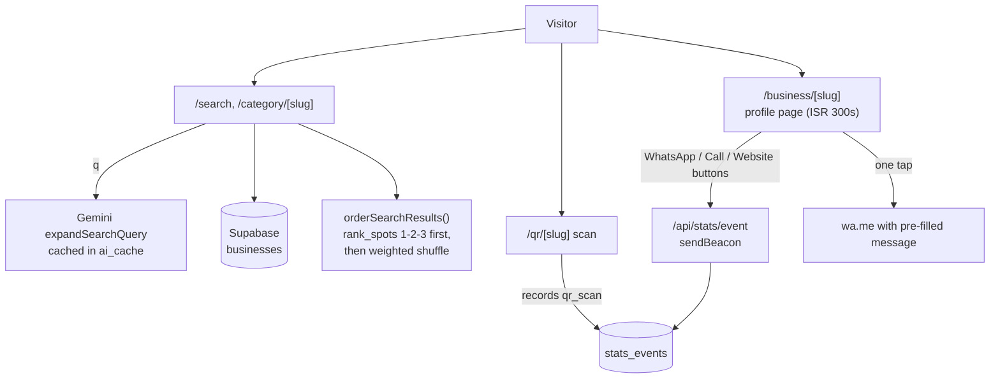
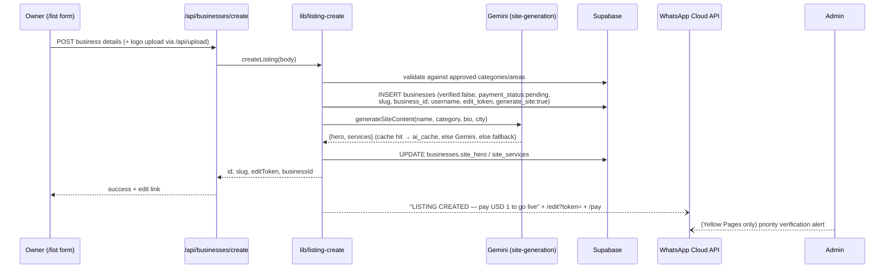
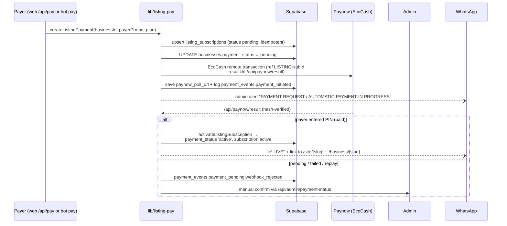
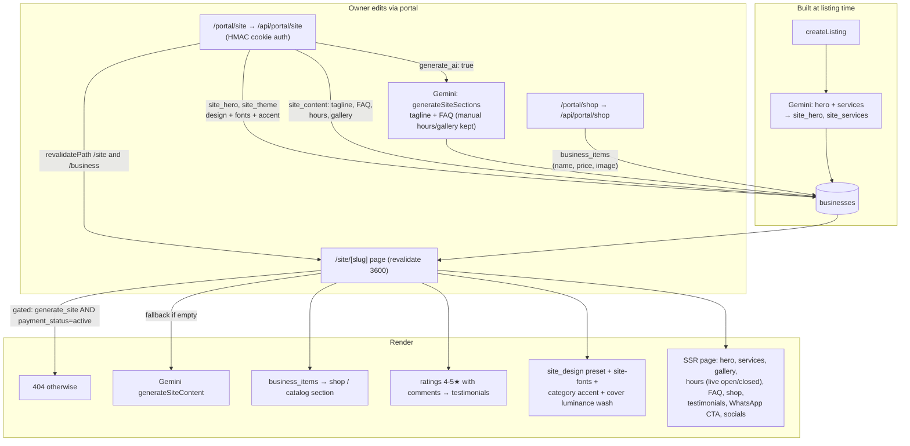
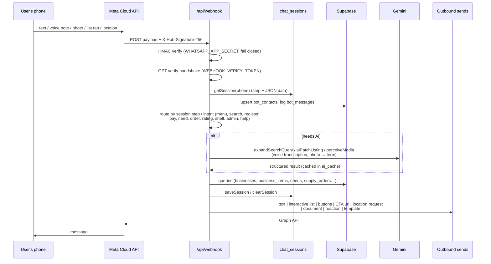
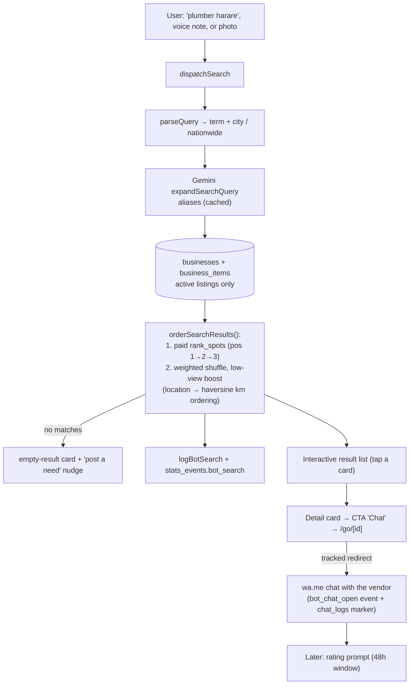
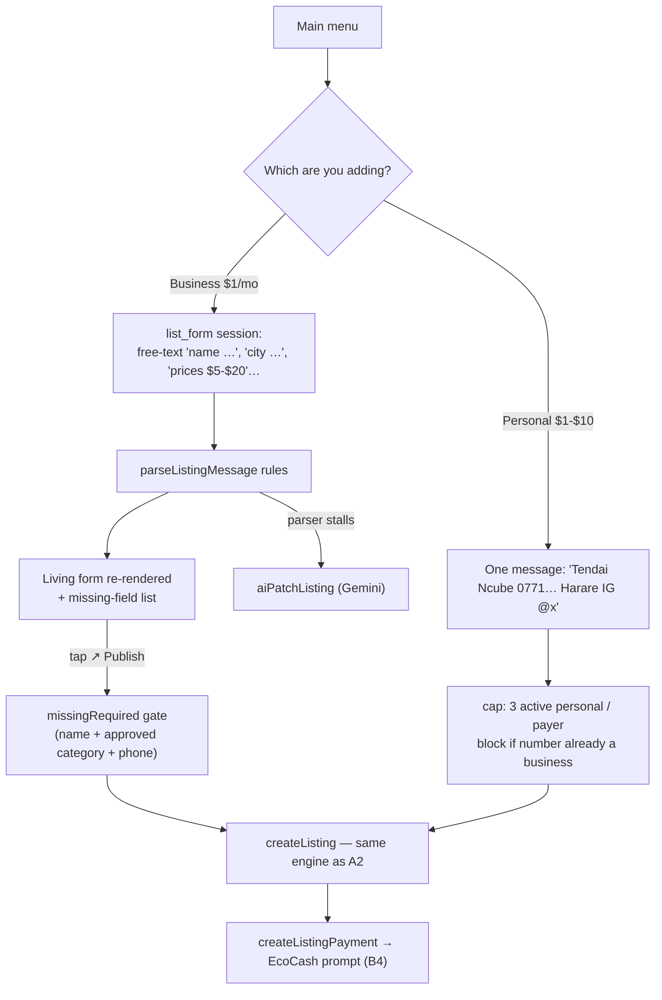
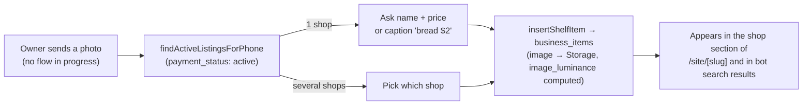
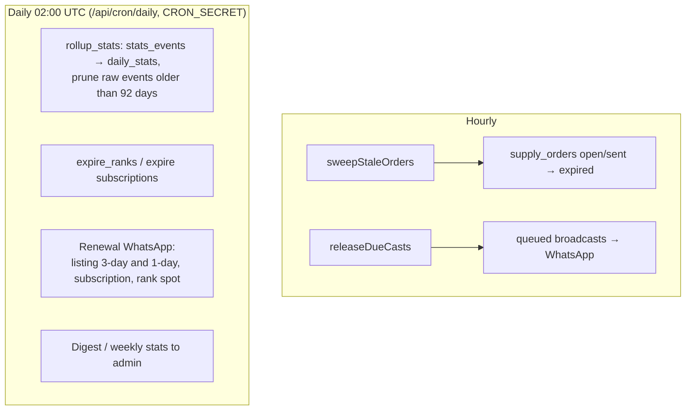

# WA Directory — Data Flow Diagrams

**End-to-end data flow for the webapp and the WhatsApp chatbot**, from first touch to a live,
monetized listing — including the automatic website / portfolio / shop generation that happens
in between.

Companion docs: [`PROJECT.md`](PROJECT.md) (overview), [`PROFILE.md`](PROFILE.md) (deep reference),
[`report.md`](report.md) (feature narrative).

---

## 0. The cast

| Actor | Enters through | Talks to |
|---|---|---|
| **Visitor** (web) | Browser → Next.js pages | `/api/search`, `/api/stats/event`, ISR pages |
| **Customer** (WhatsApp) | WhatsApp app → Meta **Cloud API** | `POST /api/webhook` (signed webhook) |
| **Business owner** (web) | `/list`, `/edit`, `/portal/*` | `/api/businesses/create`, `/api/edit`, `/api/portal/*` |
| **Business owner** (WhatsApp) | Same bot as the customer | `/api/webhook` (register, pay, stock shelf) |
| **Admin** | `/admin` (HMAC cookie) | `/api/admin/*` + WhatsApp alerts |
| **Paynow (EcoCash)** | Server-to-server | `POST /api/paynow/result` |
| **Vercel cron** | `02:00 UTC` daily + hourly | `/api/cron/daily`, `/api/cron/hourly` |

**External services:** Supabase (Postgres + Storage), Meta WhatsApp Cloud API, Google Gemini,
Paynow (EcoCash), Vercel (host, edge middleware, cron).

---

## 1. System context — one picture

```
                        ┌───────────────────────────────┐
     Browser ───────────►                               │
   (webapp pages,        │      NEXT.JS 14 APP         │      supabase-js        ┌──────────────────────┐
    portal, admin)       │                             │  (service role)         │   SUPABASE           │
                         │  /search  /business  /site  ├────────────────────────►│   Postgres           │
  WhatsApp user ────────►│  /list    /edit    /portal  │                         │   + Storage (logos,  │
   (Cloud API webhook)   │  /admin   /qr     /go       │                         │   photos)            │
                         │                             │                         └──────────────────────┘
  Meta Cloud API ◄──────►│  /api/webhook   ← inbound  │
   (messages, media,     │  /api/cron/*    ← cron     │─── HTTPS ───► Google Gemini (copy, search
    templates, lists)    │  /api/paynow/*  ← Paynow   │               expansion, AI form patching,
                         └─────────────────────────────┘               media perception — cached in ai_cache)
                                   │
                                   └── HTTPS ──► Paynow EcoCash (push payment → result webhook)
```

Everything that persists lives in Supabase. The webhook, the webapp routes and the cron all share
the same **service-role** client (`lib/supabase-server.ts`); browsers only ever get the anon key.

### Core tables touched by the flows below

| Domain | Tables |
|---|---|
| Directory | `businesses`, `categories`, `areas`, `banners`, `business_items` (shop shelf) |
| Auto-site | `businesses.site_hero`, `site_services`, `site_theme`, `site_content`, `generate_site`, `site_cover_luminance` |
| AI cache | `ai_cache` |
| Bot state | `chat_sessions`, `bot_contacts`, `bot_messages`, `chat_logs` |
| Payments | `listing_subscriptions`, `payment_events`, `subscriptions`, `rank_spots`, `bids` |
| Marketplace | `needs`, `need_quotes`, `supply_orders` |
| Trust | `ratings`, `reviews` |
| Analytics | `stats_events` → `daily_stats` (rollup) |
| Broadcasts | casts queue (via `lib/casts.ts`), `bot_settings` |

---

## 2. TRACK A — Webapp flows

### A1. Discovery & trust loop (visitor)



- Events written: `profile_view`, `click_whatsapp`, `click_call`, `click_website`, `impression`,
  `qr_scan`, `share_web`, `bot_search`, `bot_chat_open`.
- `/qr/[slug]` and `/go/[id]` are tracked redirects: they insert an event, then bounce into
  WhatsApp (QR → chat with the vendor, `/go/<id>` → chat opened from a bot result, `go/o/<token>` → order checkout).

### A2. Listing creation (web form → row → AI website copy)



**Same engine, three doors:** the web form (`/api/businesses/create`), the WhatsApp bot
(`✎ Register`), and admin `add` all call `lib/listing-create.ts`, so validation, DB shape,
AI site copy and confirmations are identical.

- `generate_site` defaults to **true** for businesses (personal contacts pass `false`).
- The row lands `verified:false`, `payment_status:'pending'` (Yellow Pages / emergency categories
  skip straight to `active` + a priority admin alert).

### A3. Payment → activation (the gate to everything public)



- Audit trail: `payment_events` records `payment_initiated`, `payment_init_failed`,
  `payment_confirmed`, `payment_pending`, `webhook_rejected`, `activation_failed`, `activation`
  (IPs stored only as a SHA-256 hash).
- Admin path and Paynow path both funnel through the same activation helper, so a listing can
  never be `active` without a `listing_subscriptions` row behind it (Yellow Pages excepted).
- Renewals: the daily cron sends 3-day and 1-day WhatsApp reminders, then flips expired rows to `expired`
  (the listing and its auto-site drop out of public views until re-paid).

### A4. Automatic website / portfolio generation — `/site/[slug]`

This is the "in-between" artifact: every active business with `generate_site:true` gets a
public site at `SITE_URL/site/<slug>` (ISR, revalidated hourly, plus explicit
`revalidatePath` when the owner edits).



**What the auto-site is made of:**

| Block | Source | Data |
|---|---|---|
| Hero headline + intro | Gemini at creation (`site_hero`) | `businesses.site_hero` |
| Services overview | Gemini at creation (`site_services`) | `businesses.site_services` |
| Tagline / FAQ / hours / gallery | Portal editor or AI regen | `businesses.site_content` (JSON) |
| Logo, contact, map, socials | Listing data | `businesses.*` |
| **Shop / portfolio shelf** | Bot photo + "bread $2" or portal shop | `business_items` |
| Testimonials | Bot-captured ratings | `ratings` (4–5★, non-empty comment) |
| Theme, fonts, accent | Portal / category default | `site_theme`, `site-fonts`, `category-style` |
| SEO | `generateMetadata` + `opengraph-image` | dynamic OG image, JSON-LD |

The profile page (`/business/[slug]`) links to the site (`generate_site && active` shows the
"Visit website" card), so directory → profile → website → WhatsApp chat is the intended funnel.

### A5. Analytics pipeline (web + bot, one funnel)

```
web clicks ──► /api/stats/event ─┐
bot searches ─► stats_events rows ├─► stats_events (append-only, 92-day retention)
QR / go scans ─► /qr, /go ───────┘         │
                                            ▼  daily cron → rollup_stats()
                                    daily_stats (per business × day × type)
                                            │
                        ┌───────────────────┴────────────────────┐
                        ▼                                        ▼
              /portal (overview, improve, CSV)          /admin statistics tab
```

### A6. Admin approval loop

```mermaid
flowchart LR
    N["New listing<br/>(pending)"] --> A["/admin → Listings tab<br/>or WhatsApp bot admin commands"]
    A -->|reject| X[deleted / message sent]
    A -->|approve| V["verify: true<br/>activateListingForDays / notifyBusinessLive"]
    V --> DB[(businesses)]
    V--)|WhatsApp| O["Owner: ✅ LIVE +<br/>/business/[slug] + /site/[slug]"]
    DB --> PUB["Appears in search, categories,<br/>sitemap, OG images"]
```

Admin actions also fire WhatsApp notifications for verification, payment confirmation,
subscription activation, bid confirmation and password resets — all routed through
`lib/whatsapp.ts` templates when an approved template exists.

---

## 3. TRACK B — WhatsApp chatbot flows

### B0. Inbound pipeline (every message)



- **Fail-closed security:** no valid signature → payload rejected (anti toll-fraud, fake
  listings/ratings). Every outbound send is mirrored to `bot_messages` for transcripts.
- Session state (`chat_sessions`) is what lets a multi-step flow — form filling, order building,
  need drafting, rating — survive across messages.

### B1. Search (the core loop)



Tiered results: service/business match → cheapest matching shelf item
(`business_items`, price-sorted) → "price not listed" fallback card.

### B2. Media becomes intent

```
voice note ──► fetchWhatsAppMedia ──► Gemini perceiveMedia (transcript) ─┐
photo ───────► fetchWhatsAppMedia ──► Gemini perceiveMedia (term+city) ──┤
                                                                          ▼
                                        mid-registration? ─► fills form fields / logo
                                        otherwise ─────────► dispatchSearch (B1)
rate limit: 3 media tries/hour per phone, always with a text fallback
```

### B3. Registration from chat (✎ Register)



### B4. Pay from chat (`$ Pay (EcoCash)`)

```
menu_pay → searchPayBusinesses (find the listing by name/username)
        → createListingPayment (identical engine to A3)
        → Paynow push to the payer's phone → /api/paynow/result auto-activates
        → admin gets a WhatsApp alert either way
        → user gets "enter your PIN → live automatically" (or manual-confirm wording)
```

### B5. Orders — "🧺 Order items" (chat → shop shelf → suppliers)

```mermaid
sequenceDiagram
    participant B as Buyer
    participant W as Bot
    participant DB as Supabase
    participant S as Supplier

    B->>W: "order 2 bread" (+ more lines)
    W->>W: parseOrderLine → matchOrder against<br/>business_items + active listings
    W->>B: order verify card (grouped shop by shop)
    B->>W: ✅ Send order
    W->>DB: createSupplyOrder → one supply_orders row<br/>per shop (group_id, token, lines, status)
    W->>B: CTA per shop: /go/o/&lt;token&gt; (one-tap checkout)
    W->>S: push: DM if they messaged the bot in 24h,<br/>else approved template, else silent
    S->>W: tap "✅ I can supply"
    W->>DB: claimSupplyOrder (status open → sent → claimed)
    W->>B: "Shop confirmed (2 × bread)" + wa.me chat CTA
    Note over W,DB: hourly cron sweeps stale orders (sent → expired)
```

### B6. Needs & quotes — "🛒 Post a need"

```
buyer: "50 bags cement harare $40-60"
   → need_form session → confirm → createNeed (needs row, RQ-xxxx id)
   → buyer gets posted card + quick replies (quotes / close / post)
   → EVERY admin gets the need + a copy-paste channel post
   → suppliers reply "<RQ-id> quote $55" → need_quotes row
   → buyer gets quote cards → taps ✅ → need closed with winner,
     other suppliers notified, buyer + winner numbers shared
```

### B7. Trust capture — ratings & reviews

```
chat opened via /go/[id] (marker in chat_logs, 48h window)
   → next message triggers "Did you chat with X? Rate 1-5"
   → ratings row (customer_phone, name from bot_contacts, comment)
   → refreshBusinessRating() → businesses.rating + review_count
   → shown on /business/[slug] and as testimonials on /site/[slug]
   (a mid-rating message that reads like a search exits and searches instead)
```

### B8. Shelf stocking from chat → feeds the auto-site shop



Caption parsing: `bread $2`, `2kg cement 7.50` → name + price. Same table is edited from
`/portal/shop`. Luminance drives text contrast on the site card.

### B9. Admin-in-chat, broadcasts, handoff

| Capability | Flow |
|---|---|
| Admin commands | `adminNumbers()` = `ADMIN_WHATSAPP` + `bot_settings.admin_allowlist`: list/unverified listings, approve, payment-status, CSV exports (businesses / people / chats), channel link, digest |
| Casts (broadcasts) | `enqueueCast(audience, text)` → hourly cron `releaseDueCasts` → chunked sends (`SYNC_MAX_SENDS`, `MAX_AUDIENCE` cap) |
| Weekly digest | `compileDigest` + cursor → admin digests of activity |
| Human handoff | bot can't help → messages forwarded to admin WhatsApp, admin replies through the bot |
| Contact consent | `bot_contacts` opt-in/opt-out, idle nudge sweeps (`sweepIdleNudges`) |
| Help / menu | deterministic fallback: unknown interactive payload never traps the user |

---

## 4. Cron flows (the metronome)



---

## 5. Start to finish — the whole story in one line per stage

1. **Discover** — visitor searches the web (`/search`, Gemini-expanded, rank-ordered) or messages
   the bot ("plumber harare" / voice / photo → same query pipeline).
2. **Connect** — profile card or bot result → tracked link (`/qr`, `/go/[id]`) → WhatsApp chat with
   the vendor; a `stats_events` row is written on the way.
3. **Onboard** — owner registers on `/list` **or** by chatting `✎ Register`; both hit
   `createListing`, which inserts the row, mints slug/business-id/username/edit-token, and asks
   Gemini for the site hero + services copy.
4. **Pay** — `createListingPayment` opens a pending `listing_subscriptions` row and pushes an
   EcoCash prompt via Paynow; `/api/paynow/result` verifies the hash and activates
   (admin manual confirmation is the fallback; `payment_events` audits everything).
5. **Publish** — `payment_status: active` + admin verification unlock search/category/sitemap
   placement, the `/business/[slug]` profile, and the auto-site.
6. **Auto-website** — `/site/[slug]` renders the generated hero/services, portal-edited
   tagline/FAQ/hours/gallery, theme/fonts/accent, live-open hours, the shop shelf
   (`business_items`), testimonials (`ratings`), OG image and JSON-LD — ISR-cached, revalidated
   on every portal save.
7. **Stock the shop** — owner sends a product photo + "bread $2" in chat (or uses `/portal/shop`);
   the item appears on the website and in bot search results with its price.
8. **Get found & transact** — buyers search, chat, place orders (`supply_orders` pushed to
   suppliers), or post needs (`needs` → supplier quotes → winner introduction).
9. **Get trusted** — bot prompts for a 1–5 rating after the chat; averages sync to the listing
   and 4–5★ comments become website testimonials.
10. **Grow & renew** — portal reads rolled-up analytics; premium subscriptions and monthly
    rank-spot bids monetize visibility; cron expires and reminds owners on WhatsApp; payment
    re-opens step 4.

---

## 6. Quick reference — which route writes what

| Trigger | Route / lib | Writes |
|---|---|---|
| Web form submit | `POST /api/businesses/create` → `listing-create` | `businesses`, `ai_cache` |
| Bot `✎ Register` | `webhook` → `listing-create` | `businesses`, `chat_sessions` |
| Logo / photo upload | `POST /api/upload`, bot `uploadLogoImage` | Supabase Storage |
| Pay (web or bot) | `/api/pay`, `listing-pay` | `listing_subscriptions`, `payment_events`, `businesses.payment_status` |
| EcoCash result | `POST /api/paynow/result` | activation (`businesses`, subscriptions), `payment_events` |
| Admin approve | `/api/admin/verify`, `admin-verify` | `businesses.verified`, WhatsApp notifies |
| Portal site save | `POST /api/portal/site` | `site_hero`, `site_theme`, `site_content`, `revalidatePath` |
| Portal shop | `/api/portal/shop` | `business_items` |
| Bot shelf photo | `webhook` → `insertShelfItem` | `business_items` |
| Web tracking | `POST /api/stats/event` | `stats_events` |
| Bot search | `webhook` → `dispatchSearch` | `stats_events`, `bot_searches`/logs, `chat_sessions` |
| Chat opened from result | `/go/[id]` | `stats_events`, `chat_logs` marker |
| Order | `webhook` → `commitPendingOrder` | `supply_orders` |
| Need / quote | `webhook` → `createNeed` / `addNeedQuote` | `needs`, `need_quotes` |
| Rating | `webhook` → `handleRatingReply` | `ratings`, `businesses.rating` |
| Cron | `/api/cron/daily`, `/api/cron/hourly` | `daily_stats`, expiries, reminders, casts, order sweep |

---

*Diagram convention: solid arrows = synchronous request/response, `--)` = fire-and-forget
notification (never blocks the primary flow), Mermaid blocks render on GitHub.*
